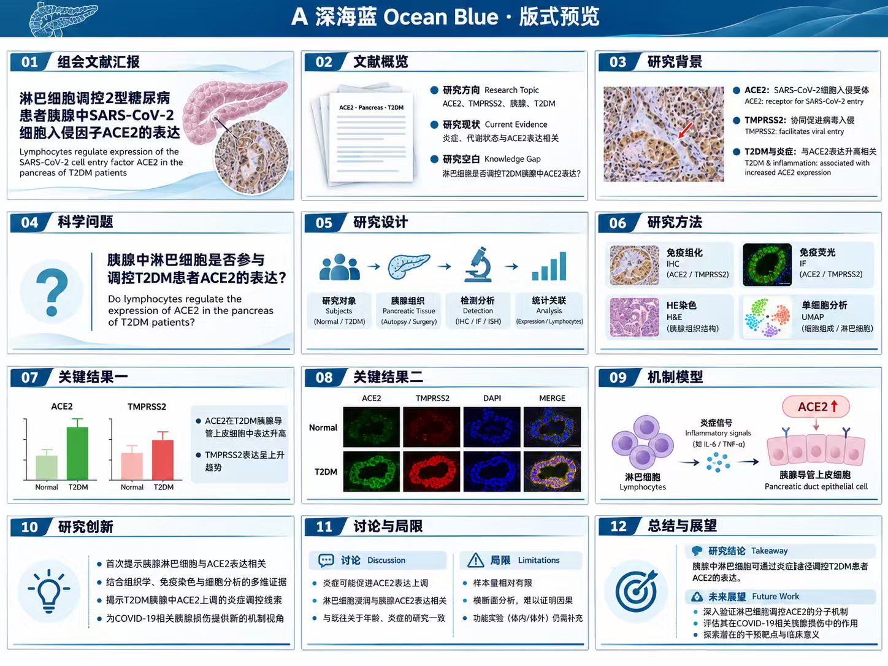
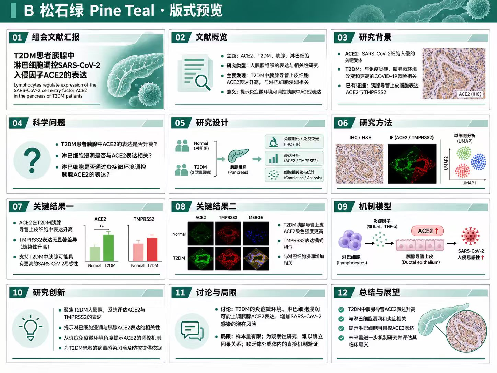
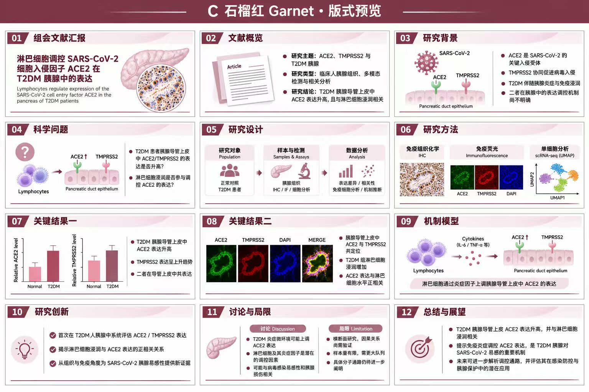
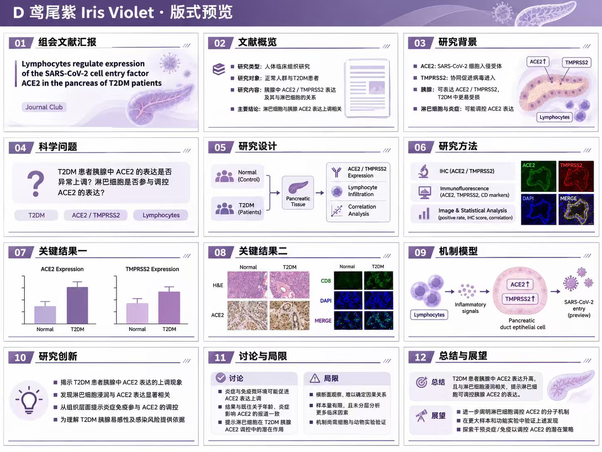

# 学术组会 PPT

`academic-ppt` 是用于课题组文献汇报、论文精读和 Journal Club 的 Codex Skill。它默认先给出四套配色预览，选定后再根据论文制作 **12 页、16:9、中英文混排**的可编辑演示文稿。

## 安装

### 在 Codex 中安装

在 Codex 对话中调用内置的 `$skill-installer`，并指定本仓库的技能目录。

```text
$skill-installer 请安装 https://github.com/hejin145/sci-ppt/tree/main/academic-ppt
```

### 手动安装（macOS / Linux）

首次安装时，在终端执行以下命令，将完整的技能目录复制到 Codex 的用户技能目录。

```bash
git clone --depth 1 --branch main https://github.com/hejin145/sci-ppt.git sci-ppt
mkdir -p "$HOME/.agents/skills"
cp -R sci-ppt/academic-ppt "$HOME/.agents/skills/"
```

两种安装方式任选其一。安装后在 Codex 对话中输入 `$academic-ppt`，或从技能列表选择「学术组会 PPT」。如果列表中还没出现该技能，重启 Codex 后再试。[Codex 技能文档](https://learn.chatgpt.com/docs/build-skills#where-codex-loads-local-skills)

## 使用

1. **提供论文。** 上传可读的论文 PDF，或提供 DOI、论文链接。相关补充材料、数据和参考风格图也可一并提供。
2. **生成预览。** 调用 `$academic-ppt`。默认生成 A、B、C、D 四套配色，每套以幻灯片浏览视图展示 12 张缩略图。只有参考图时，可以先看版式，再补论文。
3. **确认风格并制作。** 在同一对话回复所选方案。正式稿会串起研究背景、科学问题、研究设计、方法、关键结果、机制模型、创新点、讨论与展望，并为主要数据和图表标注文献出处。

首次调用示例

```text
调用 $academic-ppt 把我上传的论文做成12页学术ppt，先给我看四套配色预览。
```

选定风格后，在同一对话继续

```text
选 B 松石绿。请根据论文制作正式 PPT，并在结果页标出原文图号和数据来源。
```

如果已经确定风格，可以在首次调用时指定方案，并明确要求直接出稿。预览依赖图像生成能力，正式稿依赖演示文稿制作能力。按当前环境提供 `.pptx` 或可导出 `.pptx` 的演示文稿。

## 四套风格预览

以下图片用于展示配色与版式。正式汇报的研究内容与数据以原始文献为准。点开任一图片可查看原图。

### A · 深海蓝

[](docs/previews/a-ocean-blue.jpg)

### B · 松石绿

[](docs/previews/b-pine-teal.jpg)

### C · 石榴红

[](docs/previews/c-garnet.jpg)

### D · 鸢尾紫

[](docs/previews/d-iris-violet.jpg)
